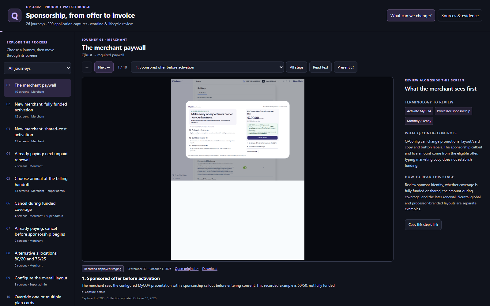
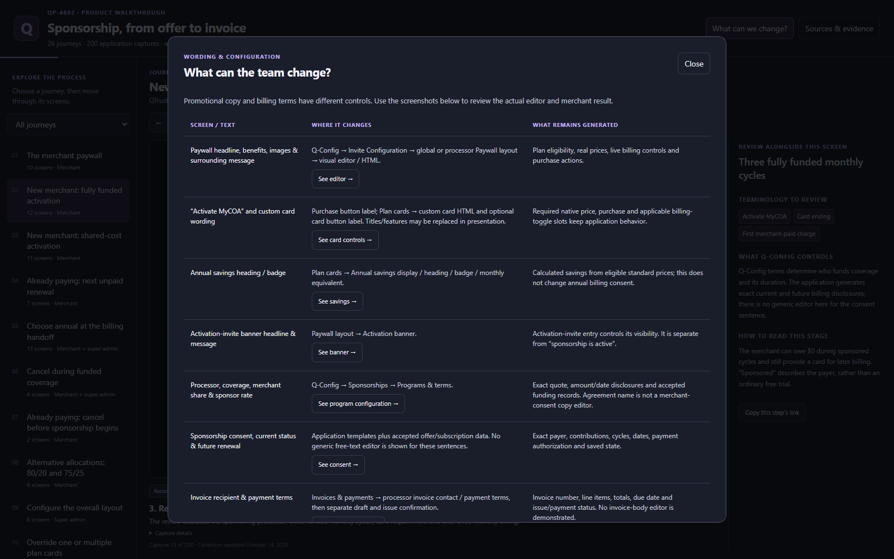
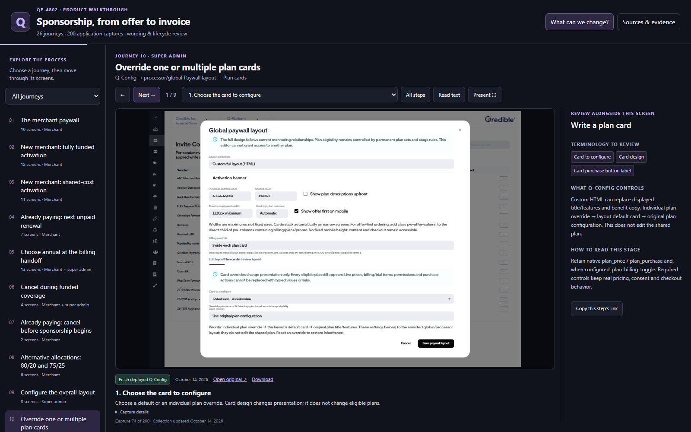
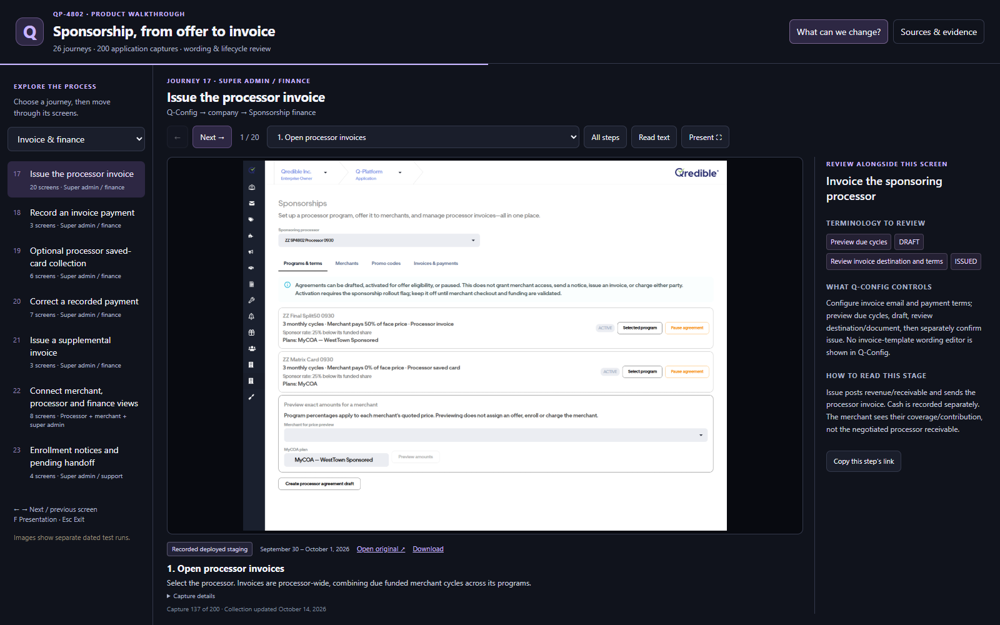
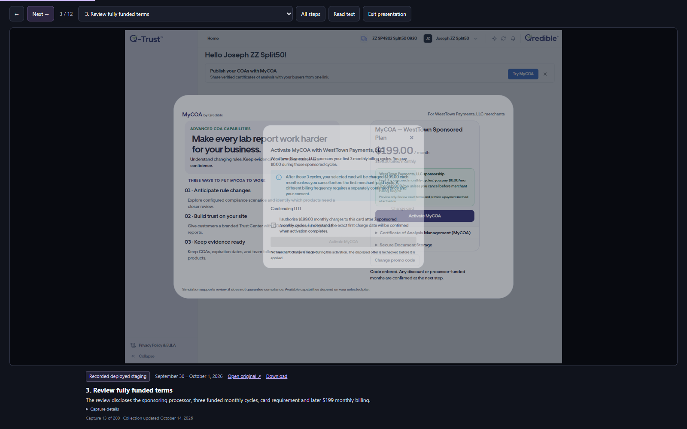
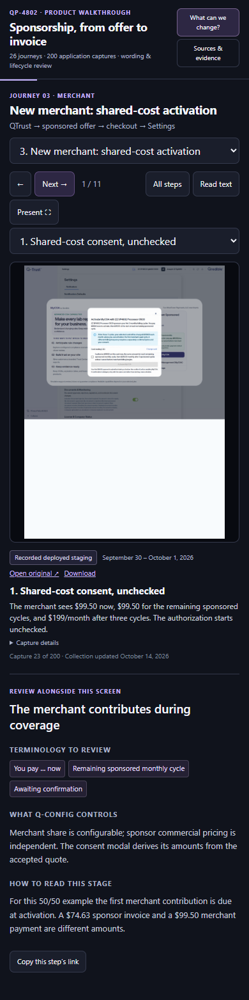

# QP-4802 sponsorship walkthrough and wording review

The requested Bearplane/jfloyd-prototypes walkthrough is served from
`qredible/mycoa-sponsorship-journeys/` (Netlify publish directory: `qredible`).
Shareable deployed preview: https://deploy-preview-99--jfloyd-qredible.netlify.app/mycoa-sponsorship-journeys/
Reviewable PR: https://github.com/Bearplane/jfloyd-prototypes/pull/99
It contains **26 journeys / 200 captures**, with merchant, Q-Config/wording and
invoice/finance review paths. Presentation mode, keyboard navigation, per-step
share links, original-image downloads and a wording/control matrix are included.

## Capture environments

- **11 fresh October 14, 2026 Q-Config captures**: normal sign-in and deployed
  `config.qrediblestaging.com/sponsorships` and `/invite-config` routes, Playwright
  with Chromium/Chrome 155.0.8059.79; no HTTP mocks. Program, merchant, promo,
  invoice, paywall HTML, card HTML, savings and activation-invite banner controls
  reviewed. Form selections were unsaved. One screenshot is a direct screenshot
  of the actual program-form region, captured on the same normal application page.
- **48 recorded deployed staging captures**, September 30–October 1: normal
  Members/Q-Config routes, synthetic test companies, owning FLEX NMI Test Account,
  no HTTP mocks. Includes genuine test sale/callback, issued invoice, actual
  received PDF/message and post-invoice reporting evidence from the original run.
  No billing/issue/notice operation from that run was repeated.
- **141 preserved earlier captures** from the previously merged gallery, mostly
  full local applications. Their fake provider/callback responses, MailHog and
  synthetic/admin-attested settlement limits remain explicit on each slide.
  Joseph's supplied plan-card capture retains its unverified-environment label.

Current merchant billing, production behavior, bank settlement and elapsed future
recurring charges were **not revalidated**. Local confirmed annual, correction,
cancellation and schedule examples are explanatory local evidence. A historical
paid-renewal date defect is dated and is not described as today's deployment state.
Fresh Q-Config screenshots verify review of controls, not persistence of new settings.

Source associations were checked against Jira and all five linked, merged QP-4802
implementation PRs. The dated staging report is RTQ-Admin-API PR2804. Images are
copied unchanged; `capture-manifest.json` records relative sources and SHA-256
for the 59 additions. No credentials or browser storage states are committed.

## Reproduce site validation

Use installed `@playwright/test` and Chromium. Set `PLAYWRIGHT_MODULE` to the module
path if necessary; `CHROMIUM_PATH` optionally chooses an installed Chrome binary.

```powershell
python -m http.server 4328 --bind 127.0.0.1 --directory qredible
$env:GALLERY_URL = 'http://127.0.0.1:4328'
node validation/mycoa-gallery/validate.cjs
```

The test visits all 200 images through normal site chapter/Next controls and checks
captions, environment badges and notes. It exercises keyboard/back/next, chapter
transitions, thumbnails, text reading, presentation/Escape, wording-guide jumps,
clipboard/deep-link reload, filtered paths, evidence dialog and desktop/mobile
layouts at 1600, 1280 and 390 pixels. `result.json` and the site screenshots are the
local full-site result. Hosted preview proof is recorded separately under `hosted/`.
This is website E2E, not a repeat of product payment E2E.

Hosted Chromium validation passed on the Netlify preview above: 200/200 images,
26 journeys, all listed controls and responsive widths, zero page errors and zero
failed responses. The tested site source was commit `66ad2d6033a36d8c555bc8d296f639fe376dc3a2`;
the subsequent proof commit only records test artifacts, documentation and the
harness wait for initial image-source readiness. It does not change the site.

```powershell
$env:GALLERY_URL = '<verified Netlify preview origin>'
$env:VALIDATION_OUTPUT = 'validation/mycoa-gallery/hosted'
node validation/mycoa-gallery/validate.cjs
```

## Reproduce capture assembly

The sanitized 141-capture baseline is `archived-captures.json`. It contains no
workstation paths. The current builder adds 48 dated RTQ API captures and the
11 fresh Q-Config screenshots, preserving bytes and generating the provenance data.
The older `sanitize-data.cjs` imports only the historical gallery and is not the
builder for this walkthrough.

```powershell
$env:QP4802_EVIDENCE_ROOT = '<RTQ-Admin-API checkout containing docs/validation/qp4802>'
node validation/mycoa-gallery/assemble.cjs
```

To repeat the read-only Q-Config review with an existing authorized login record:

```powershell
$env:STAGING_LOGIN_FILE = '<private existing connection.local.md>'
node validation/mycoa-gallery/capture-staging.cjs
```

The capture script reads the existing `Staging Q-Trust Login` section in memory,
signs in through the actual UI, and closes the browser without saving credentials
or sessions. It never clicks Save, Activate agreement, offer confirmation,
invoice issue, cancellation, consent, settlement or payment submission.

## Validation screenshots








Fresh application captures and their result are in `staging-20261014/`.
